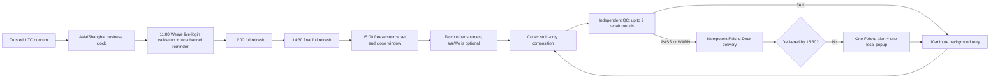

# Architecture

## Time and delivery state machine

## Storage boundaries

- `RIBAO_PROJECT_ROOT` contains trusted source code and templates.
- `RIBAO_DATA_ROOT` contains drafts, reports, QC, manifests, full text, Codex work and caches. Production validation rejects the system root mount and common system temporary/home roots.
- The Codex model receives the skill, format rules, draft and limited style references through stdin only.
- Model file, shell, browser, plugin, app and multi-agent tools are disabled; the run is `--ephemeral` and read-only.
- A trusted wrapper validates schema/QC and performs final filesystem writes on the data volume.
- The small local launchd control directory holds only static config/schema and a symlink to existing Codex authentication; daily content never enters it.

## Scheduler ownership

`com.example.beijing-daily-brief-guard` is the only daily scheduler template in this repository. The WeWe relogin service is a keep-alive HTTP helper, not a second time-based report task. The guard uses a non-blocking file lock, per-day state and idempotency keys to suppress duplicate work and duplicate messages.
